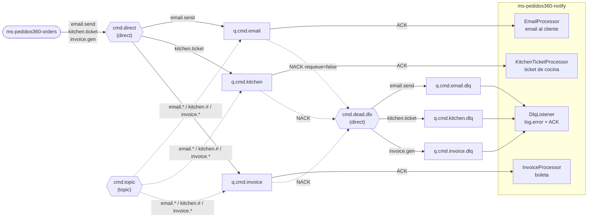

# ms-pedidos360-notify

Microservicio de notificaciones de **Pedidos360** (DSY1107). Spring Boot 4.1.1 · Java 25 · RabbitMQ · puerto **8083** (solo `/actuator/health`).
No tiene base de datos ni endpoints de negocio: **consume** los comandos que publica ms-pedidos360-orders (email al cliente, ticket de cocina y boleta) y **registra los mensajes no entregados** que llegan a las DLQ.

## Qué cubre de la evaluación
| Requisito | Implementación |
|---|---|
| Microservicio Spring Boot que compila y pasa pruebas | `./mvnw clean verify` (26 tests, sin RabbitMQ real: `Channel` mockeado) |
| Leer mensajes de las colas | Un `@RabbitListener` por cola: `q.cmd.email`, `q.cmd.kitchen`, `q.cmd.invoice` |
| ACK / NACK explícitos | `acknowledge-mode: manual`; `basicAck` si sale bien, `basicNack(requeue=false)` si falla → RabbitMQ lo manda a la DLQ por `x-dead-letter-exchange` |
| Registrar los mensajes no entregados desde las DLQ | Un `@RabbitListener` por DLQ (`q.cmd.*.dlq`): `log.error` con cola de origen, routing key, motivo y veces (`x-death`), `eventId`, `correlationId` y body; luego ACK |
| Idempotencia (entrega al-menos-una-vez) | Caché en memoria de los últimos 10.000 `eventId`: un repetido recibe ACK sin reprocesar |
| Trazabilidad | `correlationId` del sobre en el MDC: aparece en cada línea del log (`INFO [req-123] ...`) |
| Topología | Declara la misma que orders (`Declarables`) con `RABBIT_DECLARE_TOPOLOGY=true`: notify puede arrancar antes que orders |
| Docker | `Dockerfile` multi-stage con usuario no root, `docker-compose.yml` (imagen GHCR) + override local con Mailpit |
| `.gitignore` | Excluye `target/`, IDE, `.DS_Store` y `.env` |

## Flujo


## Colas que consume
El contrato completo (sobre, payload y propiedades AMQP) está en el README de ms-pedidos360-orders, sección "Contrato para otros servicios".

| Cola | Routing key (`cmd.direct`) | Cuándo la publica orders | Qué hace notify |
|---|---|---|---|
| `q.cmd.email` | `email.send` | Al crear y en **cada** cambio de estado | Arma el email (asunto y cuerpo según `estadoNuevo`). Con `MAIL_ENABLED=true` lo envía por SMTP; si no (default), lo registra completo en el log |
| `q.cmd.kitchen` | `kitchen.ticket` | Al pasar a ACEPTADO | Registra en el log el ticket de cocina (pedido, ítems y cantidades) |
| `q.cmd.invoice` | `invoice.gen` | Al pasar a ENTREGADO | Registra en el log la boleta (ítems, precio unitario, subtotales y total) |
| `q.cmd.email.dlq` / `q.cmd.kitchen.dlq` / `q.cmd.invoice.dlq` | (`cmd.dead.dlx`) | Cuando notify hace NACK | `log.error` "MENSAJE NO ENTREGADO" con los datos de `x-death` y ACK |

Las colas y sus argumentos son **idénticos** a los de orders y de `infra/mq/definitions.json` (`x-dead-letter-exchange=cmd.dead.dlx`, `x-dead-letter-routing-key=<rk>`; las DLQ sin argumentos). Si difirieran, RabbitMQ rechazaría la declaración con `PRECONDITION_FAILED`.

### Qué pasa con cada mensaje
| Caso | Resultado | Log |
|---|---|---|
| Procesado bien | `basicAck` | `INFO [email] ACK eventId=...` |
| `eventId` ya procesado | `basicAck` sin reprocesar | `WARN ... duplicado (pedido 15): ACK sin reprocesar` |
| Error de procesamiento (SMTP caído, header `x-simular-error=true`) | Se reintenta (3 intentos, 200 ms entre cada uno); si sigue fallando: `basicNack(requeue=false)` → DLQ | `WARN Intento 1/3 falló...` y luego `ERROR ... NACK sin reencolar -> DLQ` |
| JSON inválido, sin `eventId` o sin datos obligatorios (`pedidoId`, `clienteEmail`, `items`) | `basicNack(requeue=false)` **sin** reintentos (fallaría igual) → DLQ | `ERROR ... El cuerpo no es un sobre JSON válido ...` |

## Variables de entorno
| Variable | Default |
|---|---|
| `RABBIT_ADDRESSES` | `localhost:5672` (clúster: `host1:5672,host2:5672`) |
| `RABBIT_USERNAME` / `RABBIT_PASSWORD` | `guest` / `guest` |
| `RABBIT_DECLARE_TOPOLOGY` | `true` (`false` si otro servicio ya declara la topología) |
| `MAIL_ENABLED` | `false` (modo demo: el email solo va al log) |
| `MAIL_HOST` / `MAIL_PORT` | `localhost` / `1025` (Mailpit) |
| `MAIL_USERNAME` / `MAIL_PASSWORD` | vacíos |
| `MAIL_FROM` | `no-reply@pedidos360.cl` |
| `NOTIFY_MAX_INTENTOS` | `3` (`1` = sin reintento local: el NACK es inmediato) |
| `NOTIFY_ESPERA_REINTENTO` | `200ms` |
| `NOTIFY_CACHE_EVENT_IDS` | `10000` |
| `NOTIFY_DLQ_LISTENERS` | `true` (`false`: los listeners de las DLQ no arrancan y los mensajes quedan visibles en la UI) |
| `SERVER_PORT` | `8083` |

## Ejecutar en local
Requisitos: Java 25 y Docker.

```bash
# 1. RabbitMQ: un nodo (desde ms-pedidos360-orders) o el clúster de infra/mq
(cd ../ms-pedidos360-orders && docker compose -f docker-compose.rabbitmq.yml up -d)   # UI http://localhost:15672 (guest/guest)

# 2a. notify con Maven (RABBIT_ADDRESSES=localhost:5672 por defecto)
./mvnw spring-boot:run

# 2b. o notify en Docker (compila la imagen con docker-compose.override.yml)
cp .env.example .env                      # RABBIT_ADDRESSES=host.docker.internal:5672
docker compose up -d --build

# 2c. con correos reales a Mailpit (UI http://localhost:8025): en .env MAIL_ENABLED=true, MAIL_HOST=mailpit
docker compose --profile mail up -d --build

curl http://localhost:8083/actuator/health   # {"status":"UP"} (aunque Rabbit o el SMTP estén caídos)
./mvnw clean verify                          # tests (sin RabbitMQ ni SMTP)
```

Con `RABBIT_DECLARE_TOPOLOGY=true`, notify crea exchanges, colas y bindings al conectarse, así que puede arrancar antes que orders. Después se levantan orders, catalog y su PostgreSQL como indica el README de orders, y con su `requests.http` se recorre crear → aceptar → preparar → despachar → entregar. Los logs de notify muestran el email de cada cambio, el ticket de cocina al aceptar y la boleta al entregar.

## Guion de demo de las DLQ
Preparación: RabbitMQ y notify corriendo. Se abren lado a lado la UI de RabbitMQ (http://localhost:15672) y los logs de notify (`docker compose logs -f notify` o la consola de `./mvnw spring-boot:run`).

1. **Mostrar la topología.** En *Queues and Streams* se ven las 3 colas con su `.dlq`. En `q.cmd.email` → *Features* aparecen `DLX` y `DLK` (`cmd.dead.dlx` / `email.send`). Hay 1 consumidor en cada cola (notify).
2. **Caso feliz.** *Exchanges* → `cmd.direct` → *Publish message*:
   - Routing key: `email.send`
   - Properties: `content_type` = `application/json`, `correlation_id` = `demo-ok`
   - Payload: el sobre de ejemplo del README de orders (cambiando el `eventId`)

   En el log aparece `[demo-ok]` con el email armado y `ACK eventId=...`. La cola vuelve a 0.
3. **Idempotencia.** Se publica **el mismo** mensaje otra vez: el log muestra `WARN ... duplicado ... ACK sin reprocesar` y no se arma un segundo email.
4. **Error simulado → DLQ.** Mismo mensaje con otro `eventId` y, en *Headers*, `x-simular-error` = `true`. En el log aparecen:
   - `WARN Intento 1/3 falló: Error simulado...`, luego `2/3`
   - `ERROR ... NACK sin reencolar -> DLQ`
   - `ERROR MENSAJE NO ENTREGADO en q.cmd.email.dlq: colaOrigen=q.cmd.email exchange=cmd.direct routingKey=email.send motivo=rejected veces=1 eventId=... correlationId=... body=...`

   Ese último log es la evidencia de "registrar los mensajes no entregados desde las DLQ".
5. **Repetir para las otras colas**, con routing key `kitchen.ticket` (→ `q.cmd.kitchen.dlq`) e `invoice.gen` (→ `q.cmd.invoice.dlq`).
6. **Ver el mensaje parado en la DLQ** (opcional). Se reinicia notify con `NOTIFY_DLQ_LISTENERS=false` y se repite el paso 4. En la UI, `q.cmd.email.dlq` muestra *Ready: 1* sin consumidores. *Get messages* (Ack mode: *Nack message requeue true*) muestra el header `x-death` (`queue=q.cmd.email`, `reason=rejected`, `count=1`, `routing-keys=[email.send]`) y el `x-simular-error`. Luego se reinicia notify con `NOTIFY_DLQ_LISTENERS=true`: el listener de la DLQ lo consume, registra el `log.error` y la DLQ queda en 0.
7. **Mensaje mal formado** (opcional). Se publica en `email.send` el payload `{esto no es json`. Va directo a la DLQ, sin reintentos: es un error permanente. En el log de la DLQ aparece `eventId=null` y el body crudo.

> Para que el error simulado vaya directo a la DLQ, sin reintentos, se usa `NOTIFY_MAX_INTENTOS=1`.

## Decisiones de diseño
- **ACK manual y NACK sin reencolar.** `requeue=false` hace que RabbitMQ aplique el `x-dead-letter-exchange` de la cola. Con `requeue=true`, un mensaje que siempre falla se reentregaría en bucle.
- **Los listeners reciben el cuerpo crudo.** La factory de listeners usa un converter que no convierte, y la deserialización se hace dentro de `ConsumidorComandos` con el mismo `JacksonJsonMessageConverter` de orders (Jackson 3) y un tipo destino fijo. Así se ignora el `__TypeId__` de orders, que nombra una clase que no existe en notify. Si el adaptador de `@RabbitListener` convirtiera antes de llamar al método, un JSON inválido o un `__TypeId__` desconocido fallaría fuera del listener y, en modo `manual`, el mensaje quedaría *unacked* para siempre. Eso pasó en la primera prueba de punta a punta y lo cubre `ListenerAdapterTest`.
- **Reintento local acotado** (3 intentos, 200 ms, configurable). Aplica a los errores de procesamiento, que pueden ser transitorios, e incluye el error simulado, para que la demo muestre los reintentos y luego la DLQ. Los mensajes inválidos no se reintentan. Es un bucle en el mismo hilo (sin Spring Retry): durante la espera, ese consumidor no toma otros mensajes.
- **Idempotencia en memoria.** LRU de los últimos 10.000 `eventId`. Un `eventId` se registra solo después de procesarlo con éxito, así que un mensaje que falló no queda marcado. Funciona con **una réplica**: con varias réplicas, o para sobrevivir a reinicios, haría falta un almacén compartido (Redis con TTL o una tabla con `eventId` único).
- **Listener de DLQ que siempre hace ACK.** El objetivo es dejar la evidencia en el log, no reprocesar. Si el mensaje no se puede leer, igual registra el body crudo y hace ACK, para no dejarlo bloqueado en la DLQ.
- **Modo demo del email** (`MAIL_ENABLED=false`, default). No hace falta un SMTP para demostrar el flujo. Con Mailpit se ven los correos reales sin enviar nada a Internet.
- **Health sin Rabbit ni mail** (`management.health.rabbit/mail.enabled=false`), igual que orders: que caiga el broker o el SMTP no debe dejar el servicio en DOWN, porque los listeners se reconectan solos.
- **Estados como texto en el DTO** (`"ACEPTADO"`). Notify no se acopla al enum de orders, y un estado nuevo cae en un asunto genérico ("Actualización de tu pedido").
